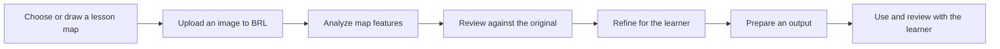

# Bringing Roadmaps to Life

**Created at the AI + Learning Differences Hackathon at Harvard School of Education**

**Team:** Bela Sanchez Taipe, Gregory Bournassenka, Aubrey Coyne, Joyce Fobi, Dev Siva, Katie Sevier, and Jenny Long

> “BRL turns teacher-drawn or selected maps into tactile maps in minutes, so teachers of deafblind students can give them high-quality visuals without extra time or costly resources.”

## Our Goal

Bringing Roadmaps to Life (BRL) aims to make rich map-based learning more accessible to students who are deafblind. Teachers should be able to start with a map that fits their lesson and create a useful tactile learning resource without needing specialized design skills, a long production process, or expensive tools.

The app is designed around the teacher's workflow: choose a map, let BRL prepare an editable interpretation, review it with the learner's needs in mind, and produce an output for classroom use. The goal is to make that process take minutes, while keeping the teacher in control of what the final map communicates.

## The Teacher's Journey

1. **Choose a map for the lesson.** A teacher selects an existing map or draws one for the learning activity. The teacher saves or photographs it as an image to bring into BRL.
2. **Upload the map.** BRL accepts PNG, JPEG, and WebP images. The teacher can use Easy Mode for a simple starting point or Advanced Mode to choose recognition, map, content, and output settings.
3. **Generate a first interpretation.** BRL analyzes the image and creates an editable representation of detected map features and labels. Processing runs in the background, and the app shows progress.
4. **Review it together.** The teacher compares the generated preview with the original, checks uncertainty notes, and decides which features matter for the learner and lesson.
5. **Make it fit the learner.** The teacher can hide or restore features, change labels and categories, or describe a change for BRL to apply. Changes can be undone or redone.
6. **Prepare the map for use.** The current app can download SVG, PDF, or PNG files. Teachers should inspect the result and work with their usual production process before using it as a tactile learning resource.
7. **Learn from the experience.** The intended outcome is a map that supports the learner's understanding of the lesson. Teacher and learner feedback can guide what to simplify, emphasize, or change next time.

## What the App Does Today

The current web app turns an uploaded map image into a structured, editable representation. It can detect geometry and text using local computer-vision and OCR tools, with optional AI-assisted interpretation when configured. Users can compare the source and preview, review warnings, edit map elements, refine the result, and export a visual file.

The BANA 2022 preparation profile translates English UEB braille through Liblouis, applies physical layout checks, and exports SVG, PDF, PNG, or a production ZIP with key pages and a validation report. Detected layout errors block production exports. Qualified braille proofreading and a physical tactile proof are still required; device compatibility and final tactile usability have not been validated. Analysis can be approximate, so review every feature and warning.

Projects are temporary. The browser remembers the current project for the session, while the API stores its files locally and removes them after the configured session lifetime (12 hours by default).

